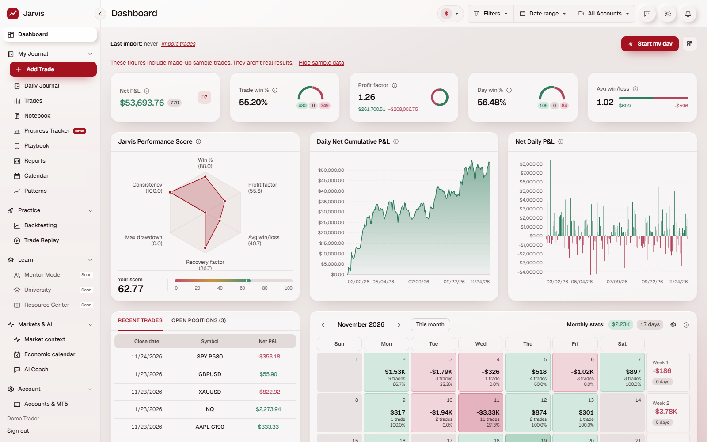
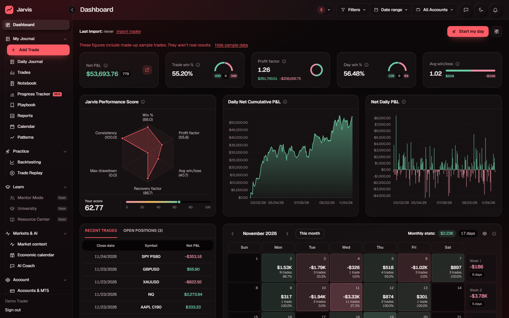
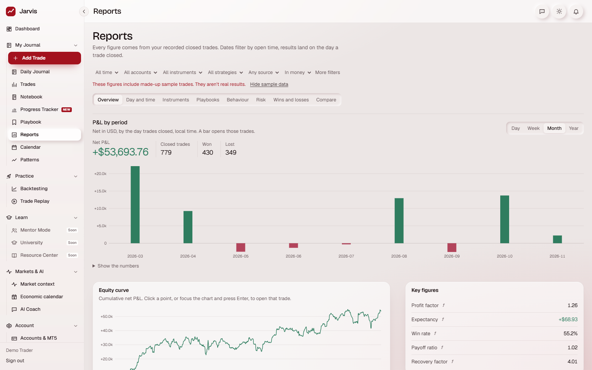
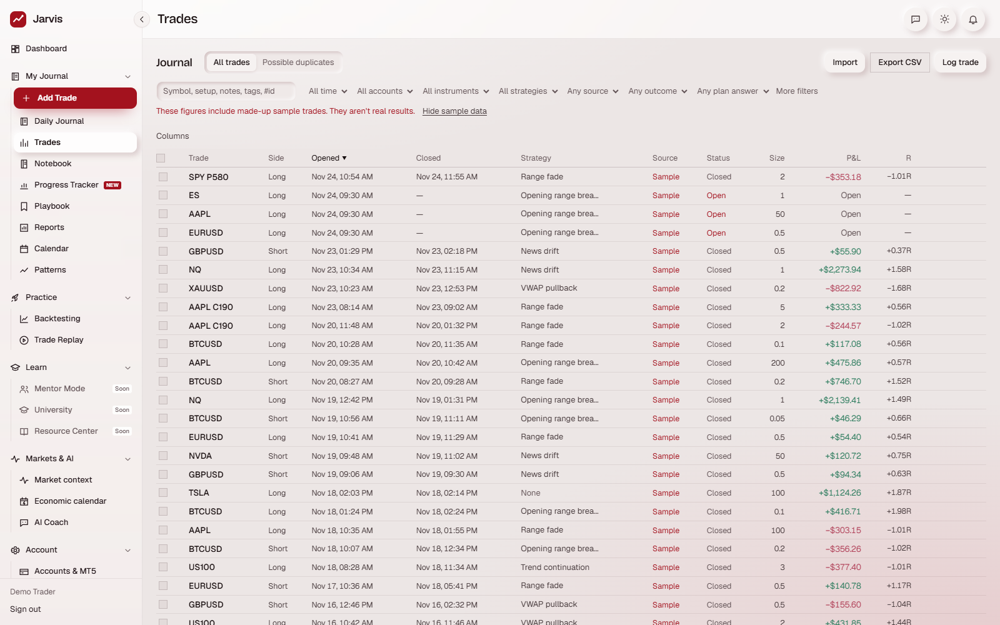
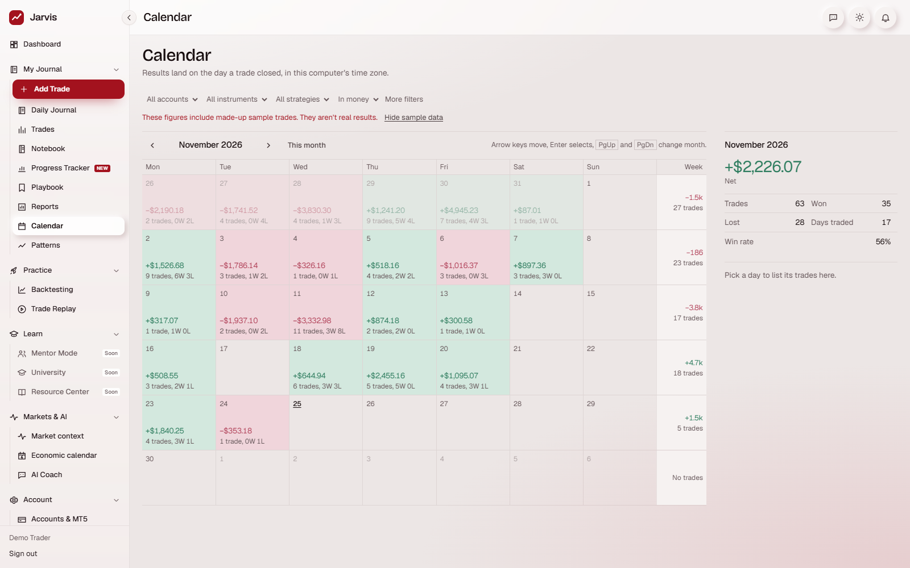
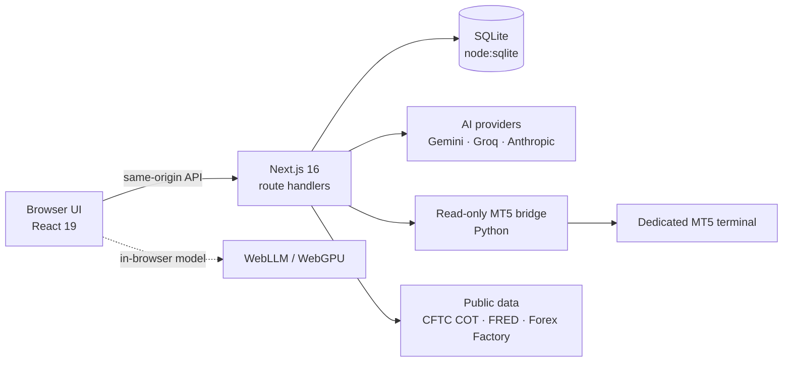

# Trading Journal

A private, local-first trading journal and performance platform for MetaTrader 5 traders.
Jarvis gathers every trade into one record (MT5 sync, file import or manual entry), computes
honest statistics from it, and gives the trader the tools to review, plan and improve:
analytics, a P&L calendar, playbooks, a notebook, backtesting, trade replay, prop-challenge
tracking, a market-context scorecard, an economic calendar that fills itself with the week's
high-impact releases, and an AI coach you can talk to that works only from the trader's own records.
The coach is free to use: it can run entirely in the browser with no API key, or on the
trader's own free Gemini or Groq key.

> **The source code is private.** This repository is a showcase: screenshots, features, stack
> and architecture. A code walkthrough is available on request.

| | |
|---|---|
|  |  |
|  |  |

## Features

**Journal**
- Trade log with sortable columns, saved views, bulk actions and CSV export
- Import from CSV or Excel with column mapping, explicit number and date formats, and duplicate detection
- Read-only MetaTrader 5 sync through a broker-issued investor login
- Daily journal, notebook with folders, templates, links and version history, and attachments

**Analysis**
- Dashboard with KPI cards, cumulative P&L, a month calendar and a 0–100 performance score
- Reports: wins and losses, risk, R-multiples, MAE / MFE, and side-by-side comparisons
- Behavioural pattern detection with sample-size gates and linked evidence
- Price charts with trade markers, plus trade and day replay

**Process**
- Playbooks with rules, checklists, adherence tracking and missed trades
- Backtesting sessions on historical broker prices
- Prop-firm challenge tracking with rule-breach alerts
- Routines, streaks, goals, spending and periodic reviews

**Market context**
- Per-pair scorecard from public data: CFTC Commitments of Traders positioning, FRED macro
  data (rates, rate trend, growth, unemployment), economic-release surprises, and the pair's
  own seasonality and trend from MT5 daily bars
- Every factor is shown separately with its source and date; context for a review, not a signal
- Gold (XAUUSD) leads every table

**Economic calendar**
- The week's high-impact releases from Forex Factory are added automatically, checked at most once an hour
- Manual entry and CSV import for anything else; each row shows its source, forecast and previous
- An optional rule tags trades opened within 15 minutes of a high-impact release for their symbol

**AI coach**
- Reflective coaching chat grounded in the trader's own statistics, citing trades as `[#id]`
- Retrieval-augmented answers: the trades, journal days, notebook pages and playbooks that fit each
  question are found locally (SQLite full-text search plus a small on-device embedding model) and
  given to the model, scoped to the signed-in user
- Voice: speak to the coach and have its replies read aloud, using the browser's built-in speech
  recognition and synthesis
- Free to use: a model that runs entirely in the browser (WebGPU, no API key), or the trader's own
  free Gemini or Groq key; Anthropic and an offline demo mode are also supported
- Switch models from inside the chat
- User-controlled memory and a privacy setting that decides exactly what is shared with a provider
- Never gives buy or sell instructions and never places trades

## Tech stack

| Layer | Technology |
|---|---|
| Framework | Next.js 16 (App Router), React 19, TypeScript |
| Styling | Tailwind CSS v4 with a token-based design system, light and dark themes |
| Data | SQLite through Node's built-in `node:sqlite`, versioned migrations |
| Validation | Zod at every API boundary |
| Charts | Lightweight Charts, custom SVG charts |
| AI | Provider interface: WebLLM in the browser, OpenAI-compatible Gemini / Groq, Anthropic SDK; retrieval with SQLite FTS5 and Transformers.js (all-MiniLM-L6-v2); Web Speech API for voice |
| Broker | Python service using the `MetaTrader5` package (read-only) |
| Marketing site | GSAP, Lenis, Motion, Three.js / React Three Fiber |
| Testing | Node test runner (unit and integration), Playwright (end-to-end) |

## Architecture

- **Derived, not stored.** P&L, R and every statistic are computed on read from the raw
  executions, so a corrected trade updates every figure at once.
- **Unknown stays unknown.** Missing fees, stops or prices are kept as `null` and flagged,
  never turned into zero.
- **Currencies are never mixed.** Totals cover one account currency at a time.
- **Providers are swappable.** AI and market data sit behind interfaces; adding one needs no UI changes.

## Security and privacy

- Local accounts with scrypt-hashed passwords, constant-time comparison, a login rate limit
  and one-time recovery codes
- Per-user data isolation on every query, verified by cross-user end-to-end tests
- HTTP-only, same-site session cookies and a strict Content-Security-Policy
- MT5 investor passwords and users' AI keys encrypted with AES-256-GCM, with the key stored apart from the database
- The MT5 bridge contains no trading calls and only ever attaches to its own dedicated terminal
- Encrypted backups; chat content and notes are never logged

## Testing

Linting, strict TypeScript, unit and integration tests on Node's test runner, and a Playwright
end-to-end suite covering the main journeys, responsive layouts from 320 px to 1920 px, and
security: every API route rejects missing, forged and revoked sessions, and one user can never
read or change another user's data.

## Disclaimer

Jarvis is a journaling and education tool. It does not place trades and does not provide
financial, investment or psychological advice.

---

© Abdul Rehman. All rights reserved. No licence is granted to use, copy or modify Jarvis.
